

# 🎓 Lessionato — Plataforma de Cursos Livres

**Venda de cursos online com pagamento via PIX, prova final e certificados em PDF com validação pública**

Desenvolvida sob demanda para a **Gemba Consultoria**

-0D1117?style=for-the-badge&logo=pix&logoColor=32BCAD)

> [!NOTE]
> **Estudo de caso.** O Lessionato é um sistema comercial e o código-fonte foi vendido junto com o produto, por isso não está publicado aqui. O projeto está **pausado** por decisão do cliente. Este repositório documenta a arquitetura, as regras de negócio e as decisões de engenharia, com as rotas e os fluxos reais do sistema.
>
> Os prints foram tirados rodando o projeto localmente (outubro de 2026), com um banco MongoDB temporário e dados de exemplo: cursos, aluna, apostila e certificado são fictícios, e o QR Code do pagamento é ilustrativo.

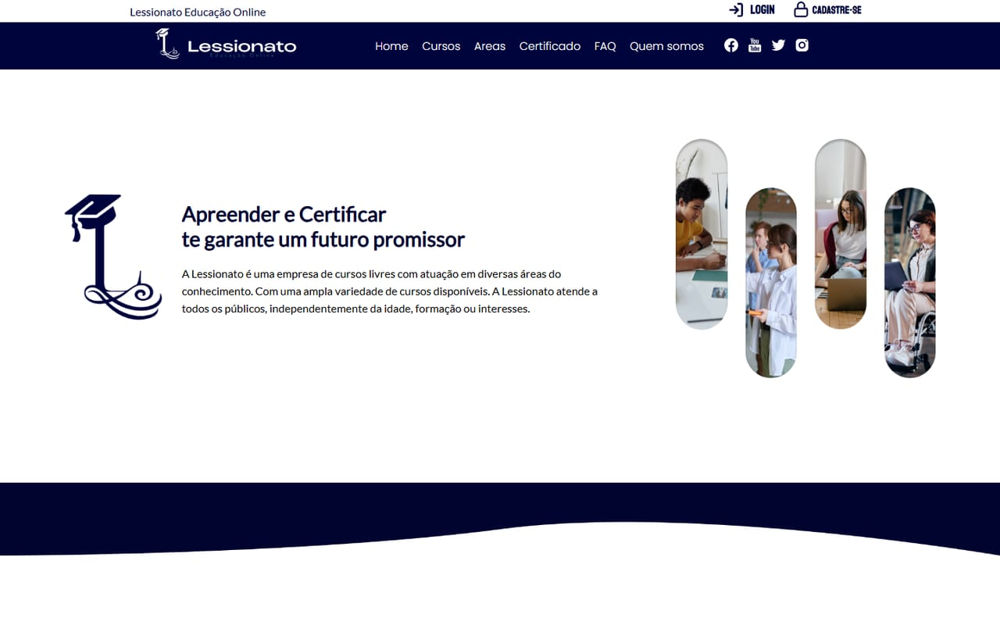

---

## Sumário

- [Visão geral](#visão-geral)
- [Arquitetura](#arquitetura)
- [Stack](#stack)
- [Funcionalidades em destaque](#funcionalidades-em-destaque)
  - [1. Pagamento via PIX com mTLS e webhook](#1-pagamento-via-pix-com-mtls-e-webhook)
  - [2. Prova final e certificado em PDF com validação pública](#2-prova-final-e-certificado-em-pdf-com-validação-pública)
  - [3. Autenticação e recuperação de conta](#3-autenticação-e-recuperação-de-conta)
  - [4. Cupons e catálogo](#4-cupons-e-catálogo)
- [Telas](#telas)
- [Rotas da API](#rotas-da-api)
- [Aprendizados](#aprendizados)

---

## Visão geral

A Lessionato vende cursos livres online. O aluno cria a conta, escolhe o curso, paga por PIX e o acesso é liberado sozinho assim que o banco confirma o pagamento. No fim do curso ele faz uma prova e, aprovado, emite um certificado em PDF com código de autenticidade e QR Code, que qualquer pessoa (um empregador, por exemplo) pode validar no site.

**Fluxo do aluno:** cadastro → catálogo (busca e categorias) → cupom de desconto opcional → pagamento PIX (QR Code) → liberação automática → conteúdo do curso → prova final → certificado.

**Área administrativa:** cadastro de cursos (com o PDF do material) e criação de cupons.

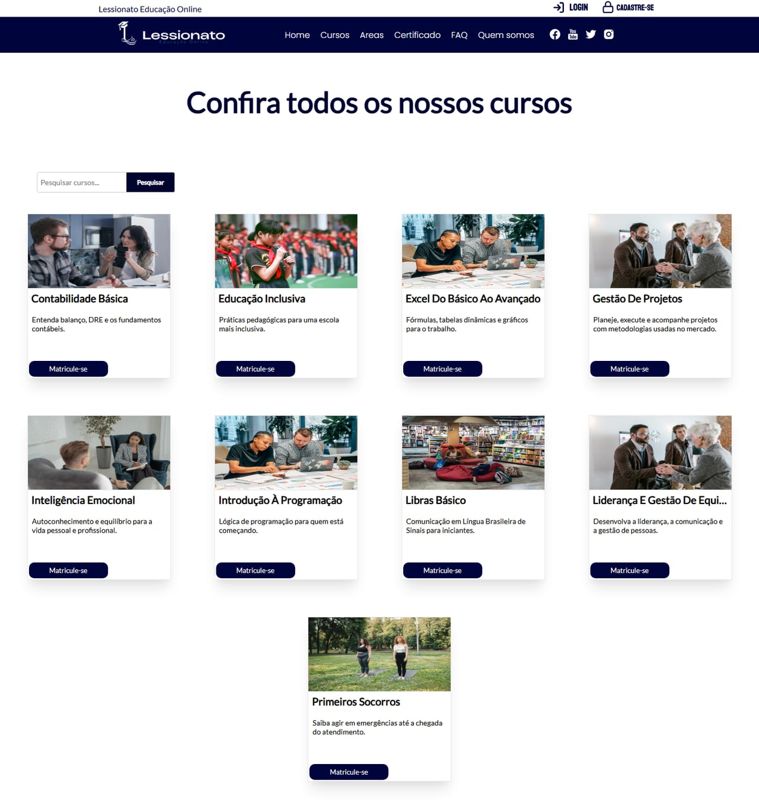

---

## Arquitetura

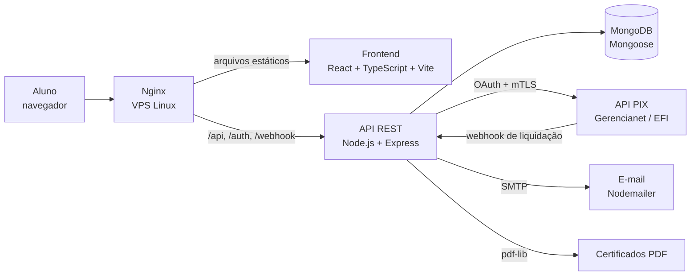

O backend segue a organização clássica do Express: **models** do Mongoose (`User`, `Curso`, `Transaction`, `Coupon`), rotas REST e middleware de autenticação. O frontend é uma SPA com rotas públicas e protegidas.

---

## Stack

| Camada | Tecnologias |
|---|---|
| **Frontend** | React 18, TypeScript, Vite, React Router, Axios, React Hook Form e Formik, layout responsivo (celular e desktop) |
| **Backend** | Node.js, Express, Mongoose, JWT, bcrypt, `crypto`, Multer (upload de PDFs), Moment-timezone (datas em `America/Sao_Paulo`) |
| **Banco** | MongoDB, com documentos para alunos e matrículas, cursos, transações e cupons |
| **Pagamentos** | API PIX da **Gerencianet (EFI)** com **mTLS** (certificado `.pfx` num `https.Agent`), OAuth e webhook |
| **Documentos** | `pdf-lib` + `@pdf-lib/fontkit` (fontes Lato embutidas) e `qrcode` |
| **E-mail** | Nodemailer (recuperação de senha e formulário de contato) |
| **Infraestrutura** | VPS Linux com Nginx; script de atualização do site com build e `rsync` |

---

## Funcionalidades em destaque

### 1. Pagamento via PIX com mTLS e webhook

O ponto técnico mais delicado foi falar direto com a API PIX da Gerencianet, que exige **TLS mútuo**: além do OAuth, cada chamada apresenta o certificado digital da empresa.

- **Cobrança imediata:** `POST /api/cursos/:id/pix` calcula o valor (já com o cupom, conferido no servidor), cria a cobrança com expiração, guarda o `txid` numa `Transaction` e devolve o QR Code e o "copia e cola" para a tela.
- **Identificação da compra:** o curso e o aluno vão no campo `solicitacaoPagador` da cobrança e voltam no webhook, para liberar o curso certo.
- **Webhook de liquidação:** a EFI acrescenta `/pix` à URL cadastrada, por isso a rota é `POST /webhook/pix/pix`. Ao receber a confirmação, a API marca a transação como paga e adiciona o curso ao aluno, com a data da compra no fuso de Brasília.
- **Confirmação na tela:** enquanto o aluno está na página de pagamento, o frontend consulta `GET /api/transactions/status/:txid` e libera o acesso assim que o status vira `completed`, sem precisar recarregar.
- **Homologação:** durante o desenvolvimento, uma rota de webhook de teste simulava a aprovação para validar o fluxo sem dinheiro real.

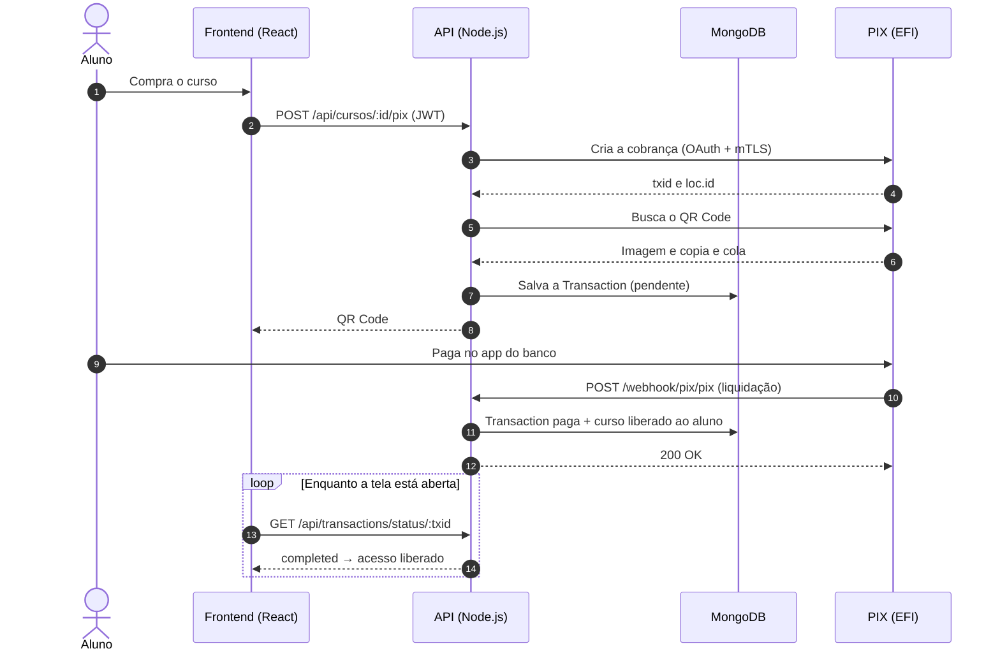

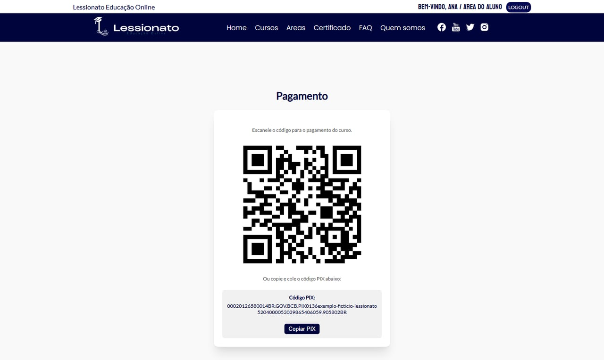

### 2. Prova final e certificado em PDF com validação pública

- **Prova final:** ao terminar o conteúdo, o aluno responde um questionário. A nota fica guardada na matrícula (`POST /api/salvaravaliacao`) e a aprovação é a partir de **60% de acerto**.
- **Certificado gerado no servidor:** a API abre um **modelo em PDF**, embute as fontes Lato (regular e negrito) com o fontkit e escreve nas posições certas o nome e o CPF do aluno, o curso, o período, a carga horária e a porcentagem de acerto.
- **Prazo de 7 dias:** em cursos pagos, o certificado só pode ser emitido depois de 7 dias da compra (o prazo de arrependimento do Código de Defesa do Consumidor), para ninguém emitir o certificado e pedir o dinheiro de volta.
- **Código de autenticidade:** cada certificado recebe um código único (`crypto.randomBytes`), guardado na matrícula, e um **QR Code** desenhado no próprio PDF que leva à página de verificação.
- **Validação pública:** `GET /api/verificar-autenticidade/:codigo` permite que qualquer pessoa confira se o certificado é verdadeiro.

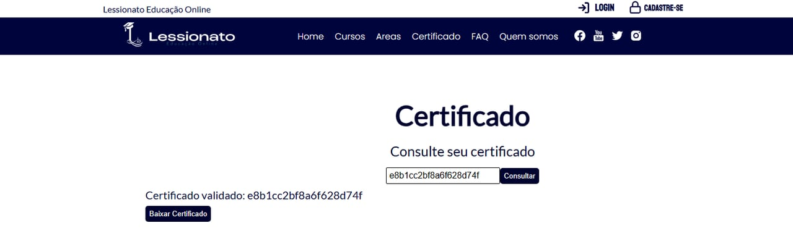

### 3. Autenticação e recuperação de conta

- **Dois tokens:** o login devolve um **token de acesso de 30 minutos** e um **token de renovação de 7 dias**; `POST /auth/token` emite um novo token de acesso sem pedir a senha de novo.
- **Rotas da área do aluno:** o middleware `checkToken` valida o JWT do cabeçalho `Authorization` (compra, conteúdo do curso, prova, cupons e dados da conta). O usuário tem papel `user` ou `admin`.
- **Senhas:** hash com `bcrypt` e custo 12.
- **Esqueci a senha:** `crypto.randomBytes(20)` gera um token de uso único, válido por **1 hora**, enviado por e-mail com o link de redefinição.

### 4. Cupons e catálogo

- **Cupons de desconto** com código único, valor do desconto, **limite de uso**, contador e **data de validade**. O administrador cria (`/api/criar-cupom`), o aluno aplica na compra (`/api/aplicar-cupom`) e a API confere de novo ao gerar o PIX, para o desconto não ser forjado no navegador.
- **Catálogo** com busca, paginação e filtro por categoria, e página pública de cada curso.
- **Páginas institucionais e legais:** FAQ, quem somos, contato, política de privacidade, política de cookies, termos e regras.

---

## Telas

**Página do curso, com cupom e inscrição**

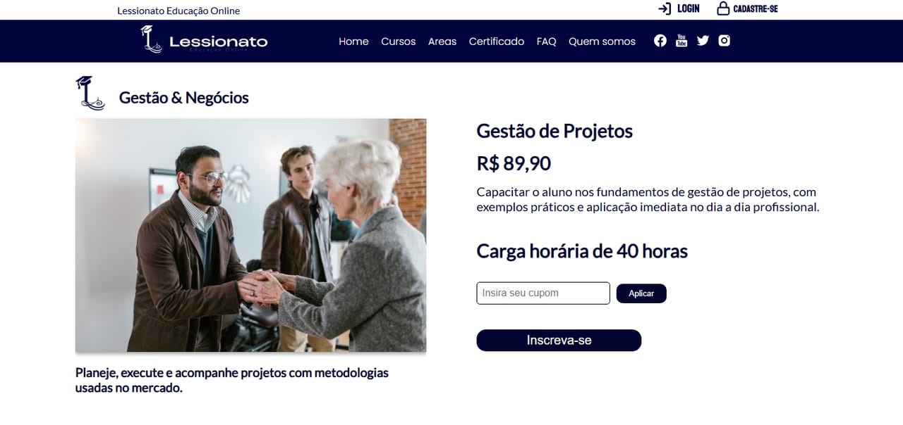

**Área do aluno**

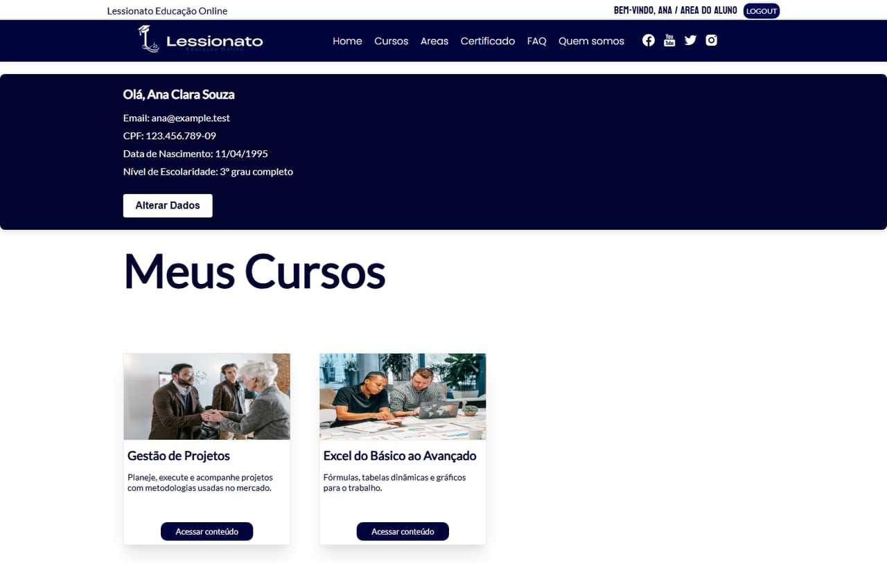

**Conteúdo do curso: apostila em PDF, materiais e regras do certificado**

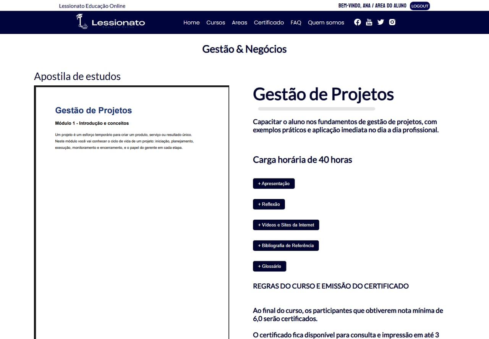

**Prova final**

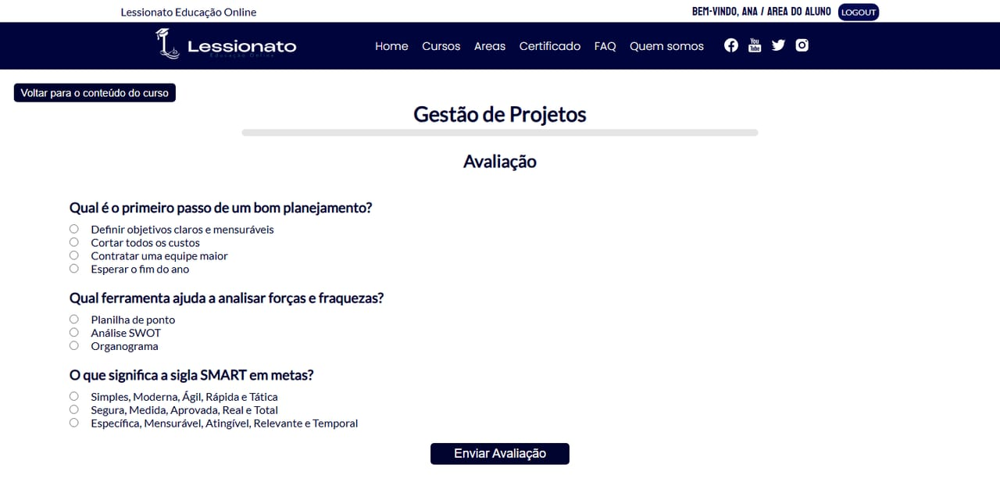

**No celular**

  
  &nbsp;&nbsp;
  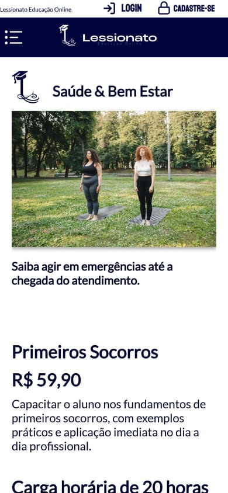

---

## Rotas da API

| Método | Rota | Quem usa | Função |
|---|---|---|---|
| POST | `/auth/register` · `/auth/login` | Público | Cadastro e login (token de acesso + renovação) |
| POST | `/auth/token` | Público | Novo token de acesso a partir do token de renovação |
| POST | `/auth/forgot-password` · `/auth/reset-password/:token` | Público | Recuperação de senha por e-mail |
| GET | `/api/cursos` · `/api/cursos/page` · `/api/cursos/search` · `/api/cursos/categoria/:categoria` | Público | Catálogo, paginação, busca e categorias |
| GET | `/api/cursos/:id/public` | Público | Página pública do curso |
| GET | `/api/cursos/:id` · `/api/cursos/:id/verificar` | Aluno | Conteúdo do curso e verificação de matrícula |
| POST | `/api/cursos/:id/pix` | Aluno | Cria a cobrança PIX |
| GET | `/api/transactions/status/:txid` | Aluno | Status do pagamento |
| POST | `/webhook/pix/pix` | EFI | Confirmação de pagamento |
| POST | `/api/aplicar-cupom` | Aluno | Aplica um cupom |
| POST | `/api/salvaravaliacao` | Aluno | Nota da prova final |
| POST | `/api/emitir-certificado` · GET `/api/certificados/:cursoId/:userId` | Aluno | Emissão e download do certificado |
| GET | `/api/verificar-autenticidade/:codigo` | Público | Validação do certificado |
| GET · PATCH | `/api/user` · `/api/user/:id` | Aluno | Dados da conta |
| POST | `/api/cursos` · `/api/criar-cupom` | Administração | Cadastro de cursos (com PDF) e cupons |
| POST | `/api/contato` | Público | Formulário de contato (e-mail) |

---

## Aprendizados

- **Certificados e TLS mútuo:** configurar um `https.Agent` com certificado `.pfx` para falar com uma API financeira, como exige o ecossistema PIX.
- **Pagamento assíncrono de ponta a ponta:** cobrança, webhook e confirmação na tela, com a transação guardada no banco para acompanhar cada pagamento.
- **Regras de negócio no servidor:** desconto, liberação do curso e aprovação conferidos na API, nunca só no navegador.
- **PDF no servidor:** editar um PDF binário em memória, com fontes e QR Code embutidos, sem ferramentas externas.
- **Sessão segura sem atrito:** token de acesso curto com renovação, e recuperação de senha com token de uso único e validade.
- **Projeto para cliente real:** levantamento de requisitos, páginas legais e entrega em produção numa VPS.

---

Desenvolvido por **[Gabriel Araújo](https://www.linkedin.com/in/gabriel-ara%C3%BAjo-a5a439277/)** · [GitHub](https://github.com/araujogbs)

