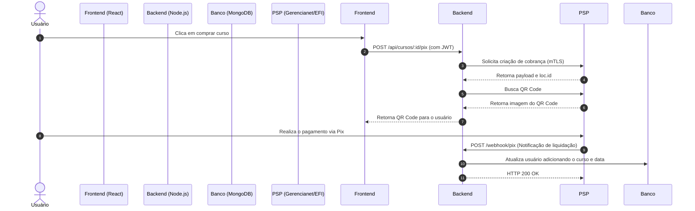

# 🎓 Lessionato EdTech - Plataforma de Cursos Livres (Gemba Consultoria)

> **Nota de Propriedade Intelectual e Status do Projeto:** 
> O **Lessionato EdTech** foi um sistema comercial desenvolvido sob demanda para a **Gemba Consultoria**, voltado à gestão, comercialização de cursos livres e emissão automatizada de certificados. Atualmente, o projeto encontra-se **temporariamente pausado** por decisão estratégica e o código-fonte proprietário foi comercializado. Este repositório atua estritamente como um **Case de Estudo Técnico**, documentando a arquitetura, o fluxo de negócios e as escolhas de engenharia implementadas.
---

## 🎯 Sobre o Projeto
O Lessionato foi idealizado para ser uma plataforma web robusta voltada para a venda de cursos online, gerenciamento de alunos, processamento de pagamentos automatizados via PIX, acompanhamento de progresso de aulas e geração dinâmica de certificados em PDF com códigos de autenticidade únicos.

&nbsp;
 

---

## 🛠️ Stack Tecnológica

### Backend
* **Runtime:** Node.js
* **Framework:** Express.js
* **Banco de Dados:** MongoDB & Mongoose (NoSQL - Modelagem orientada a documentos para flexibilidade de conteúdos e grades curriculares)
* **Autenticação & Segurança:** JSON Web Tokens (JWT), bcrypt (hashing de senhas com salt de 12 rounds), Crypto (tokens seguros de redefinição e autenticidade)
* **Integrações de Pagamento (PSP):** API Pix da **Gerencianet (EFI)** utilizando protocolo mTLS (Mutual TLS com certificados digitais `.pfx` e agentes `https.Agent` customizados)
* **Geração de Documentos:** `pdf-lib` e `@pdf-lib/fontkit` para manipulação binária, injeção de fontes customizadas e desenho vetorial em templates de certificados PDF
* **Comunicação e Utilitários:** Nodemailer (envio de e-mails transacionais via Outlook para recuperação de senha), Multer (armazenamento local de arquivos PDF e mídias), Moment-timezone (gestão rigorosa de fusos horários para datas de compra e conclusão)

### Frontend
* **Biblioteca:** React.js com TypeScript tipado estaticamente
* **Roteamento:** React Router DOM (navegação estruturada e rotas protegidas)
* **Requisições HTTP:** Axios (cliente HTTP configurado para comunicação com a API REST)
* **Estilização:** CSS Modules (isolamento de escopo de componentes e design responsivo adaptado para múltiplos breakpoints mobile/desktop)

---

## ⚙️ Principais Funcionalidades e Arquitetura

### 1. Sistema de Pagamentos Automatizados via PIX (Open Banking / PSP)
Um dos maiores desafios técnicos resolvidos no backend foi a integração direta com a API PIX da Gerencianet utilizando **mTLS (Mutual TLS)** para autenticação via certificados digitais de segurança:
* **Geração de Cobrança Instantânea:** Rota dedicada (`/api/cursos/:id/pix`) que interage com o fluxo OAuth da API de pagamentos, gerando o payload da cobrança com expiração configurada e resgatando dinamicamente a imagem do QR Code para exibição imediata na interface do usuário.
* **Webhooks de Confirmação em Tempo Real:** Endpoint assíncrono (`/webhook/pix`) estruturado para escutar notificações de liquidação de pagamento, extraindo metadados do comprador através da string de `solicitacaoPagador` e atualizando o banco de dados MongoDB em tempo real para liberar o acesso ao curso adquirido.
* **Ambiente de Homologação / Testes:** Implementação de uma rota de webhook dedicada a testes (`/webhook/test`) simulando o fluxo de aprovação de compra e registrando a data de aquisição com padronização de fuso horário de Brasília (`America/Sao_Paulo`).

## 📊 Fluxograma do Sistema (Pagamento PIX e Liberação)

  

### 2. Motor de Geração Dinâmica de Certificados em PDF
Para entregar uma experiência profissional aos alunos concluintes, desenvolvi um motor backend de emissão de certificados utilizando a biblioteca `pdf-lib`:
* O sistema carrega um template base em PDF (`modelo_certificado.pdf`), registra dinamicamente fontes customizadas (`Lato-Regular` e `Lato-Bold`) e realiza o posicionamento milimétrico de textos e variáveis (nome do usuário, CPF, título do curso, período de realização e carga horária).
* **Segurança e Validação Pública:** O sistema gera automaticamente um **Código de Autenticidade** criptografado de uso único (`crypto.randomBytes`) vinculado ao histórico do aluno. Desenvolvi também uma rota de verificação pública (`/api/verificar-autenticidade/:codigo`) permitindo que terceiros (como empregadores ou instituições de ensino) validem a autenticidade do documento de forma digital.

&nbsp;

### 3. Segurança, Autenticação e Recuperação de Conta
* **Controle de Acesso Baseado em Tokens:** Middleware customizado (`checkToken`) que intercepta requisições HTTP, validando a integridade e a validade de tokens JWT presentes nos headers de autorização.
* **Criptografia de Credenciais:** Proteção de senhas com `bcrypt` aplicando um salt de 12 rounds para mitigar ataques de força bruta.
* **Fluxo de Recuperação de Senha:** Sistema integrado via Nodemailer que gera tokens temporários criptografados (`crypto.randomBytes(20)`) com validade de 1 hora, enviando links seguros de redefinição por e-mail aos usuários.
---

## 💻 Demonstração Visual (UI / UX)

* **Página Inicial (Home):** Desenvolvida com foco em conversão e responsividade completa (Mobile/Desktop), exibindo carrosséis de cursos, destaques de categorias e seções institucionais.

&nbsp;
 &nbsp;&nbsp;&nbsp;&nbsp;&nbsp;&nbsp;&nbsp;&nbsp;&nbsp;&nbsp;&nbsp;&nbsp;

  
---

## 🧠 Aprendizados e Desafios de Engenharia
* **Domínio de Criptografia e Certificados de Rede:** Compreensão profunda de como configurar conexões HTTPS seguras utilizando agentes com certificados digitais corporativos (`pfx`), essenciais no ecossistema financeiro brasileiro (PIX).
* **Manipulação Avançada de Arquivos em Buffer:** Manipulação de streams e alteração direta de arquivos binários (PDFs) no servidor sem depender de softwares externos pesados.
* **Arquitetura Escalável em Camadas:** Organização de models, rotas e middlewares no Express, garantindo fácil manutenção e testes limpos.

---
*Desenvolvido por **Gabriel Araujo Cordeiro*** 🚀
